<div align="center">



<br />

[](https://www.linkedin.com/in/zaiddddd/)
[](mailto:zaid83560@gmail.com)
[](https://onyxfuzzx.github.io/)

**Data Analyst Intern @ Houzeo · M.Sc. AI & Business Analytics · Mumbai, India**

[About](#about-me) · [Projects](#selected-projects) · [Experience](#experience) · [Stack](#tools--technologies) · [Education](#education)

</div>


## About me

I'm **Zaid Shaikh**, a Data Science and AI graduate working as a **Data Analyst Intern at Houzeo** and pursuing an **M.Sc. in Artificial Intelligence and Business Analytics at Bhavan's College, Mumbai**.

I work with property-listing datasets ranging from thousands to lakhs of records, using **Elasticsearch, Python, and SQL** to extract, convert, and verify data. I also build full-stack applications and LLM-based tools, using **Codex and Claude Code** to automate repetitive work and turn ideas into working software.

```python
focus = {
    "data":       ["extraction", "analysis", "verification"],
    "automation": ["Python", "LLM applications", "agentic workflows", "MCP"],
    "software":   ["APIs", "full-stack apps", "ML tooling"],
}
```


## Selected projects

<table>
<tr>
<td width="50%" valign="top">

### [Feature Store & Model Registry](https://github.com/onyxfuzzx/Feature_store)

An ML platform with batch online feature retrieval, point-in-time training datasets, and scheduled materialization. The model registry links versions to the features they use and tracks drift by model version. Includes a Python SDK and CLI.

`Python` `FastAPI` `React` `PostgreSQL` `Redis`

</td>
<td width="50%" valign="top">

### [AgentCanvas](https://github.com/onyxfuzzx/AgentCanvas)

A local workspace for Codex, Claude Code, and Antigravity with terminals, task tracking, shared notes, and isolated Git worktrees. Review diffs before accepting changes.

`TypeScript` `React` `Rust` `Tauri`

[Windows x64 development preview](https://github.com/onyxfuzzx/AgentCanvas/releases/tag/v0.1.0-preview.1) for desktop, VS Code, and Antigravity.

</td>
</tr>
<tr>
<td width="50%" valign="top">

### [Attendance Buddy](https://github.com/onyxfuzzx/attendance-buddy)

A self-hostable attendance app rebuilt from QR Watchman. Employees check in via workplace QR codes with GPS verification. Admins schedule shifts, review corrections, and export records.

`TypeScript` `React` `Express` `Supabase` `PostgreSQL`

[Try the public demo with sample data](https://onyxfuzzx.github.io/attendance-buddy/demo/).

</td>
<td width="50%" valign="top">

### [The AI Chronicle](https://github.com/onyxfuzzx/AI-News-Analyzer)

Paste an article URL to get a summary, sentiment analysis, and related coverage. A LangChain search agent compares sources to generate a reliability assessment.

`Python` `Flask` `Groq` `LangChain` `BeautifulSoup`

</td>
</tr>
</table>

### More things I've built

| Project | What it does | Stack |
| --- | --- | --- |
| [Working Notebook](https://onyxfuzzx.github.io/) | Personal portfolio with interactive workflow diagrams, project case studies, and a downloadable résumé. | React · TypeScript · Vite · GitHub Pages |
| [Customer Churn Prediction](https://github.com/onyxfuzzx/customer-churn-prediction) | Trains a telecom churn ensemble, compares class-balancing strategies, and reuses preprocessing in a Flask prediction app. | Python · Scikit-learn · XGBoost · Flask |
| [QR Event Ticket Manager](https://github.com/onyxfuzzx/QR-Event-Ticket-Manager) | Event registration, encrypted QR tickets, role-based administration, and live check-in dashboards. | Angular · .NET 8 · SQL Server · SignalR |
| [FightFitAI](https://github.com/onyxfuzzx/FightFitAI) | Boxing training plans, webcam-based pose feedback, and ML-based fight predictions. | Python · Flask · OpenCV · MediaPipe |

**[Explore all my public repositories →](https://github.com/onyxfuzzx?tab=repositories)**


## Experience

### Data Analyst Intern · Houzeo

*September 2026 – Present*

- Query, extract, and analyze large property-listing datasets using Elasticsearch.
- Handle extraction from multiple sources, format conversion, and accuracy verification, including region-specific data collection.
- Build Python automations with Codex to reduce repetitive manual data work.
- Create design assets and visual deliverables with Claude Design for team analysis and reporting.

### Software & Web Development Intern · Prism Cybersoft Pvt. Ltd.

*November 2025 – February 2026*

- Delivered **8 production-ready applications**, including an LLM-powered WhatsApp Business bot.
- Built full-stack applications and REST APIs with .NET 8, C#, Angular 17, Python, and SQL Server, using JWT authentication, SignalR, and Dapper.
- Deployed applications on Azure, AWS, and Cloudflare with CI/CD pipelines, role-based access control, and BCrypt password hashing.


## Tools & technologies

<div align="center">


</div>

| Area | Technologies |
| --- | --- |
| **Languages** | Python, C#, TypeScript, JavaScript, Rust, SQL, HTML, CSS |
| **Data & analytics** | Elasticsearch, Pandas, NumPy, Matplotlib, Seaborn, Scikit-learn |
| **AI & automation** | LLM applications, AI agents, LangChain, agentic workflows, MCP, prompt engineering |
| **AI development & design tools** | Codex, Claude Code, Claude Cowork, Claude Design, Google Stitch |
| **Web, desktop & APIs** | React, Angular 17, Tauri, FastAPI, Flask, Express, ASP.NET Core, SignalR, REST APIs, webhooks |
| **Databases & storage** | Elasticsearch, Microsoft SQL Server, PostgreSQL, Supabase, Redis, MySQL, SQLite |
| **Cloud & delivery** | Microsoft Azure, AWS, Cloudflare, GitHub Pages, Git, CI/CD |

## Education

| Degree | Institution | Years |
| --- | --- | --- |
| **M.Sc. in Artificial Intelligence and Business Analytics** | Bhavan's College, Mumbai | 2026 – Present |
| **B.Sc. in Data Science and Artificial Intelligence** | Ramniranjan Jhunjhunwala College, Mumbai | 2023 – 2026 |


<div align="center">

**Have an idea involving data, AI, or useful software? Let's talk.**

[LinkedIn](https://www.linkedin.com/in/zaiddddd/) · [Email](mailto:zaid83560@gmail.com) · [GitHub](https://github.com/onyxfuzzx)

<sub>Mumbai, India · Data, AI &amp; software</sub>

</div>
